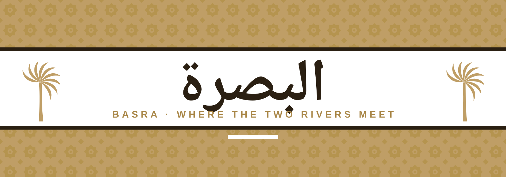

<div align="center">



<br/>

# البصرة · Basra

### رحلة ثلاثية الأبعاد على شطّ العرب

**A cinematic, scroll-driven 3D journey through the city of Sinbad, palms and the Shatt al-Arab.**
Real-time WebGL river, hand-built palms, ships, a working container port — all in Arabic, all in the browser.

<br/>


</div>

---

## ✦ What is this?

A single-page website about **Basra, Iraq** that treats the page itself as a film. You scroll — the camera flies.

It starts high above the **Shatt al-Arab**, drops onto the water, swings across the river, **orbits a palm island**, slips between *mashoof* canoes and sailing dhows, and ends in a sweeping aerial over **Umm Qasr port** — with Arabic signage, working cranes and container ships. Below the journey, the site continues as a modern Arabic magazine: destinations, 13 centuries of history, people, food, news.

> **Palette** — warm white `#FFFFFF` · Basra sand `#BF9E66` · date-palm ink `#2A1F12`
> **Patterns** — Basra *shanasheel* lattice, palm-frond weave, river-scale waves, mashrabiya diamonds — all drawn as filled shapes.

---

## ✦ Highlights

| | |
|---|---|
| 🎥 **Cinematic camera** | A Hermite-spline path with banking, FOV changes, an orbit around the island and a crane-style finish. Captions hop left/right to follow where the camera looks. |
| 🌊 **Real-looking water** | Custom GLSL shader: Fresnel sky reflection, animated micro-waves, sun glitter, shallow-to-deep colour, shoreline foam, atmospheric fog. |
| 🌴 **Procedural date palms** | Four trunk variants with ring scars, pinnate fronds (hundreds of leaflets), dry lower fronds, hanging date bunches, wind sway and real-time shadows. |
| 🚢 **Ships that move** | Cargo ship, container ship, tanker, barge + tug, dhows and *mashoof* — each with hull plating, rust streaks, railings, lifeboats, rotating radar, an Iraqi flag in the wind, funnel smoke, bow waves and foam wakes. |
| 🏗️ **Umm Qasr port** | Quay, ship-to-shore cranes that actually lift containers, RTG yard cranes, ~1,500 containers, trucks on the move, curved warehouses, control tower and **Arabic signs** ("ميناء أم قصر"). |
| 🏝️ **Palm island** | A small island in mid-river, planted with 70 palms and thousands of grass blades. |
| 🧭 **Live Basra clock** | Real local time and sunset/sunrise countdown for 30.5°N 47.8°E — computed on the client. |
| 🎠 **3D scroll sections** | Horizontal 3D gallery of destinations, stacked history cards, a rotating 3D ring of notable Basrans, tilt-on-hover cards. |
| ⚙️ **Adaptive quality** | Detects weak GPUs and frame-time drops, then removes shadows, resolution, grass and palms step by step so the page never freezes. |
| ♿ **Respectful** | `prefers-reduced-motion`, RTL layout, semantic markup, WebGL-failure fallback to a photograph. |

---

## ✦ Quick start

```bash
# 1 — clone
git clone https://github.com/malkeahmed/Basra.git
cd Basra

# 2 — install
npm install

# 3 — run
npm run dev          # http://localhost:5173

# production build
npm run build
npm run preview
```

> **Heads up:** open the site through `npm run dev` or `npm run preview`.
> Double-clicking `dist/index.html` will not work — browsers block ES modules from `file://`.

Requirements: **Node 18+** and a browser with **WebGL 2**.

---

## ✦ Project structure

```
Basra/
├─ index.html              RTL / lang="ar" shell, fonts (Reem Kufi + Tajawal)
├─ public/assets/          Photographs + credits.json (licences & authors)
├─ docs/banner.svg         README banner
└─ src/
   ├─ main.jsx             Entry — installs the SVG patterns, mounts <App/>
   ├─ App.jsx              Sections: journey, intro, places, history, people, culture, news, footer
   ├─ data.js              All Arabic copy: chapters, places, eras, people, news, credits
   ├─ styles.css           Design tokens, layout, responsive rules
   ├─ patterns.js          Basra patterns as inline SVG data-URIs
   ├─ scroll.js            One shared rAF-throttled scroll loop
   ├─ scene.js             The 3D world: terrain, river shader, camera track, quality governor
   ├─ palm.js              Procedural palms, reeds, grass blades, wind-sway material
   ├─ boats.js             Mashoof, dhow, tanker, container/cargo ships, barge + tug, wakes, smoke
   └─ port.js              Umm Qasr port: quay, cranes, containers, trucks, Arabic signs
```

---

## ✦ Make it yours

| I want to… | Edit |
|---|---|
| Change captions, history, people, news | `src/data.js` |
| Re-time or re-aim the camera | `WAYPOINTS` in `src/scene.js` — `[progress, [u,y,z] camera, [u,y,z] look-at, fov, roll]` |
| Change which side a caption appears on | `side: 'sl' \| 'sr'` per chapter in `src/data.js` |
| Make the river wider or move the island | `halfW` and `ISL` in `src/scene.js` |
| Change palm density / ship lanes | the `palmCount` constants and `place(...)` calls in `src/scene.js` |
| Re-colour the site | CSS variables at the top of `src/styles.css` and colours in `src/patterns.js` |
| Edit port signs | `signTexture(...)` calls in `src/port.js` |

*Camera coordinates:* `u` is the distance from the **left river bank** toward the water, `y` is height, `z` runs downstream (negative).

---

## ✦ Performance notes

The 3D scene is deliberately rich (instanced palms, ~11k grass tufts, a shader river, a 1,500-container yard).
On a modest laptop GPU the built-in governor automatically lowers quality. If you want to tune it manually:

- fewer palms → `palmCount` · less grass → `grassCount` · fewer containers → `cap` in `src/port.js`
- shadows are disabled automatically on small screens and weak GPUs

---

## ✦ Content & accuracy

History, figures and place descriptions are written for storytelling. **Please verify facts before publishing** (dates, capacities, quotations).
The **News** section is a *placeholder* — connect it to a real feed before launch.

---

## ✦ Photo credits

All photographs are from **Wikimedia Commons** under open licences. The full machine-readable list is in [`public/assets/credits.json`](public/assets/credits.json).

| Image | Author | Licence |
|---|---|---|
| Sunset over the Shatt al-Arab | Mohammed Abdul Hussein | CC BY-SA 4.0 |
| Port crane & bridge | Naseem95yak | CC BY-SA 4.0 |
| Basra Corniche | Lordali91 | CC BY-SA 3.0 |
| Southern Iraq marshes | Montzr 1 | CC BY-SA 4.0 |
| Statue of Badr Shakir al-Sayyab | David Stanley | CC BY 2.0 |
| Shatt al-Arab & Sindbad Island | Aziz1005 | Public domain |
| Mashoof | Sgt. Gustavo Olgiati | Public domain |
| Basra, 1915 | Unknown | Public domain |

Share-alike images are displayed unaltered. Fonts: **Reem Kufi** and **Tajawal** (SIL OFL, via Google Fonts).

---

<div align="center">

**البصرة — حيث يلتقي النهران**

*Made with sand, water and a lot of palms.*

</div>
